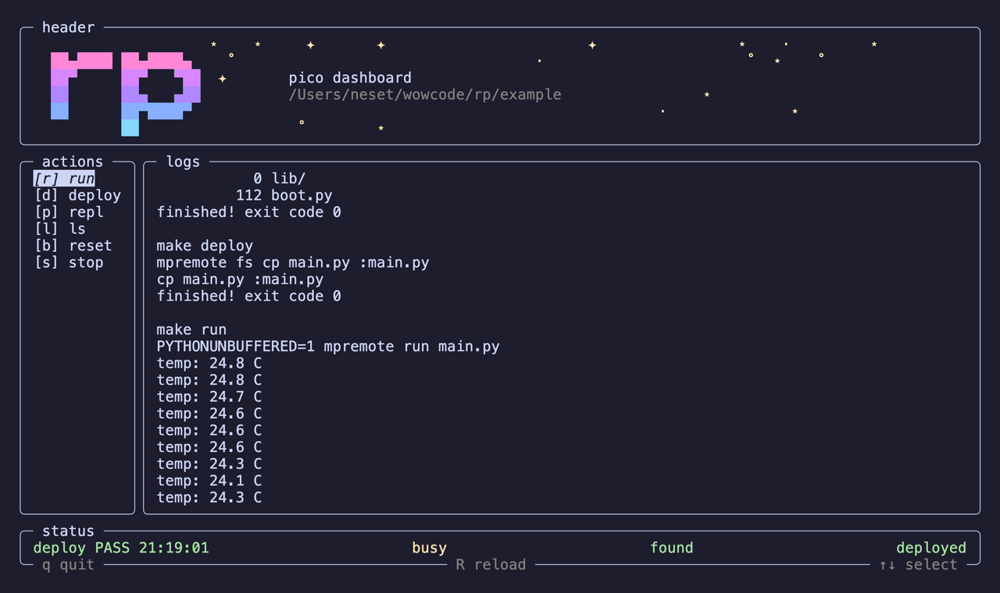

# rp

A terminal dashboard for MicroPython development on the Raspberry Pi Pico, written in C++ with ncurses.

Instead of remembering `mpremote` commands, you press one key. `rp` runs the command, streams its output live, and keeps an eye on whether your Pico is plugged in and whether your code has changed since the last deploy.




## try it (no pico needed)

mac or linux:

```sh
curl -fsSL https://github.com/nesetkab/rp/releases/latest/download/install.sh | sh
~/.local/bin/rp --demo
```

`--demo` spins up a throwaway project in `/tmp` with a fake pico and a fake `mpremote` so everything works w no hardware. `r` run, `s` stop, `d` deploy, `e` edit `main.py`, `u` unplug/replug, `p` repl, `q` quit. the demo folder gets deleted when u quit

or just grab a binary from [releases](https://github.com/nesetkab/rp/releases/latest). on windows use wsl + the linux one

## Features

- **One-key actions.** Run, deploy, open the REPL, list files, reset the board. Every action is a shell command you define in `config.json`.
- **Live output.** Commands run on a background thread, so the screen never freezes and output shows up line by line while a script runs.
- **Stop anything.** Long-running commands (like a `while True:` loop on the Pico) can be stopped with one key. `rp` stops the whole process group it started, so it works for any command, not only `mpremote`.
- **REPL in the same terminal.** Interactive actions hand the terminal over to the command (for example `mpremote repl`) and bring the dashboard back when you exit.
- **Device detection.** The status bar shows whether a board is plugged in by checking `/dev` once a second, without touching the serial port.
- **Deploy tracking.** After a successful deploy, `rp` watches the `.py` files in the current folder and tells you when something changed and has not been deployed yet.
- **Live config reload.** Edit `config.json` and press `R`. Mistakes in the config are shown in the log instead of crashing the app.
- **Responsive layout.** The panels resize with the terminal. On short terminals the big header collapses into a single line.
- **Sparkles.** The header sparkles twinkle green when the board is connected, yellow while a command runs, and red when no board is found.

## Requirements

- macOS or Linux
- A C++17 compiler (`clang++` or `g++`)
- ncurses
- [nlohmann/json](https://github.com/nlohmann/json)
- [`mpremote`](https://docs.micropython.org/en/latest/reference/mpremote.html) for talking to the Pico

On macOS with Homebrew:

```sh
brew install nlohmann-json
pip install mpremote
```

ncurses ships with macOS. On Debian or Ubuntu use `sudo apt install build-essential libncurses-dev nlohmann-json3-dev`.

## Build

```sh
git clone https://github.com/nesetkab/rp.git
cd rp
make
```

| Command | What it does |
| --- | --- |
| `make` | Builds `./rp` with optimizations |
| `make STATIC=1` | linux only, static build so it runs on other linux boxes |
| `make debug` | Builds `./rp-debug` with AddressSanitizer and UndefinedBehaviorSanitizer |
| `make install` | Copies `rp` to `/usr/local/bin` (change it with `PREFIX=~/.local`) |
| `make uninstall` | Removes the installed binary |
| `make clean` | Deletes the build folder and binaries |

## Usage

Run `rp` from the folder of your Pico project, the one with your `Makefile` and `.py` files:

```sh
cd ~/my-pico-project
rp                       # uses ./config.json
rp ~/configs/pico.json   # or point it at any config file
rp --demo                # fake pico, no hardware
```

Commands run in the folder you started `rp` from, and the deploy tracker watches the `.py` files in that folder.

### Keys

| Key | Action |
| --- | --- |
| `↑` / `↓` | Move the selection |
| `Enter` or `Space` | Run the selected action |
| Action key (`r`, `d`, ...) | Run that action directly |
| `R` | Reload `config.json` |
| `q` | Stop any running command and quit |

### The status bar

From left to right:

1. **Last result.** The last action that finished, `PASS` or `FAIL`, and the time it finished.
2. **busy / free.** Whether a command is running. Only one command runs at a time because the Pico's serial port can only be used by one program at once.
3. **found / not found.** Whether a device matching `devicePrefix` exists in `/dev`.
4. **Files.** `unknown` before the first deploy, `deployed` when nothing changed since, and `changed, not deployed` when a `.py` file was edited after the last deploy.

## Configuration

`config.json` lists the actions shown in the sidebar:

```json
{
  "devicePrefix": "cu.usbmodem",
  "actions": [
    { "label": "run",    "key": "r", "command": "make run" },
    { "label": "deploy", "key": "d", "command": "make deploy", "kind": "deploy" },
    { "label": "repl",   "key": "p", "command": "make repl",   "kind": "interactive" },
    { "label": "ls",     "key": "l", "command": "make ls" },
    { "label": "reset",  "key": "b", "command": "make reset" },
    { "label": "stop",   "key": "s", "kind": "stop" }
  ]
}
```

| Field | Meaning |
| --- | --- |
| `devicePrefix` | Start of the device name in `/dev`. On macOS a Pico shows up as `cu.usbmodem...`; on Linux it is usually `ttyACM`. Run `mpremote devs` to check yours. |
| `deviceDir` | optional, where to look for the device. defaults to `/dev` |
| `label` | Name shown in the sidebar and the status bar. |
| `key` | Single character that runs the action. `q` and `R` are reserved. |
| `command` | Shell command to run. Not needed for `stop`. |
| `kind` | Optional. One of the kinds below. Defaults to `normal`. |

| Kind | Behavior |
| --- | --- |
| `normal` | Runs in the background and streams output into the log. |
| `deploy` | Same as `normal`, and a successful run resets the deploy tracker. |
| `interactive` | Gives the whole terminal to the command (for a REPL) and returns when it exits. Exit `mpremote repl` with `Ctrl-]` or `Ctrl-X`. |
| `stop` | Stops the running command. |

Tip: MicroPython output can arrive in big chunks when it goes through a pipe. Put `PYTHONUNBUFFERED=1` in front of the command (as the example `Makefile` does) to get it line by line.

## Example project

[`example/`](example) is a tiny Pico project you can try `rp` with. `main.py` blinks the onboard LED and prints the chip temperature every second, and the `Makefile` wraps the `mpremote` commands that `config.json` expects:

```sh
make
cd example
../rp ../config.json
```

## How it works

| File | Role |
| --- | --- |
| `main.cpp` | Sets everything up and runs the main loop: draw, wait up to 100 ms for a key, handle it. |
| `Terminal.cpp` | Starts and stops ncurses and sets up the colors (RAII, so the terminal is always restored). |
| `Panel.cpp` | Wraps an ncurses window with a rounded border and a title. |
| `Layout.cpp` | Works out the size and position of each panel from the terminal size. |
| `View.cpp` | Draws the actions, logs, status bar and header. |
| `Header.cpp`, `Sparkler.cpp` | The `rp` logo and the twinkling sparkles. |
| `Runner.cpp` | Starts commands with `posix_spawn` in their own process group, reads their output on a worker thread, and stops them with `SIGTERM`. |
| `StatusCheck.cpp` | Once a second, looks for the device in `/dev` and checks `.py` files against the last deploy time. |
| `Config.cpp` | Loads and validates `config.json`. |
| `Demo.cpp` | makes the `--demo` project, fake `mpremote` + fake `/dev` + example `main.py` |
| `AppState.hpp` | The shared state between the UI thread and the worker thread, guarded by a mutex. |

## Troubleshooting

- **`config error: could not open config file`**: start `rp` in a folder with a `config.json`, or pass the path as the first argument.
- **Device shows `not found`**: run `mpremote devs` and set `devicePrefix` to the start of the name it prints.
- **A command fails right after the REPL**: the serial port is exclusive. Make sure nothing else (another terminal, Thonny, a serial monitor) has the port open.
- **The terminal looks broken after a crash**: run `reset`.
